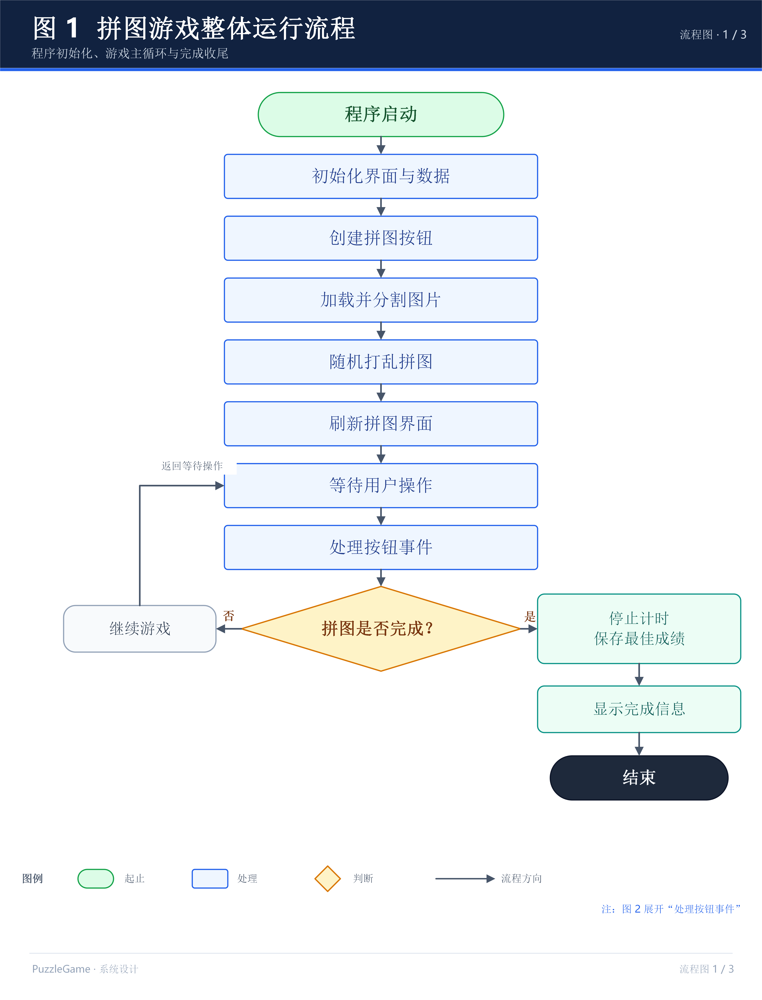
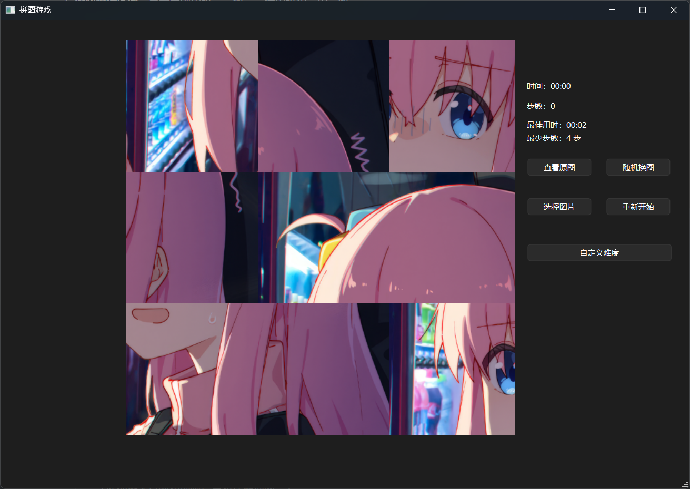
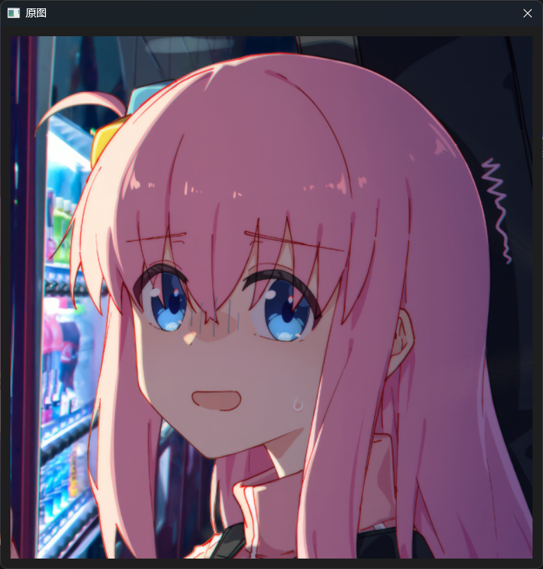
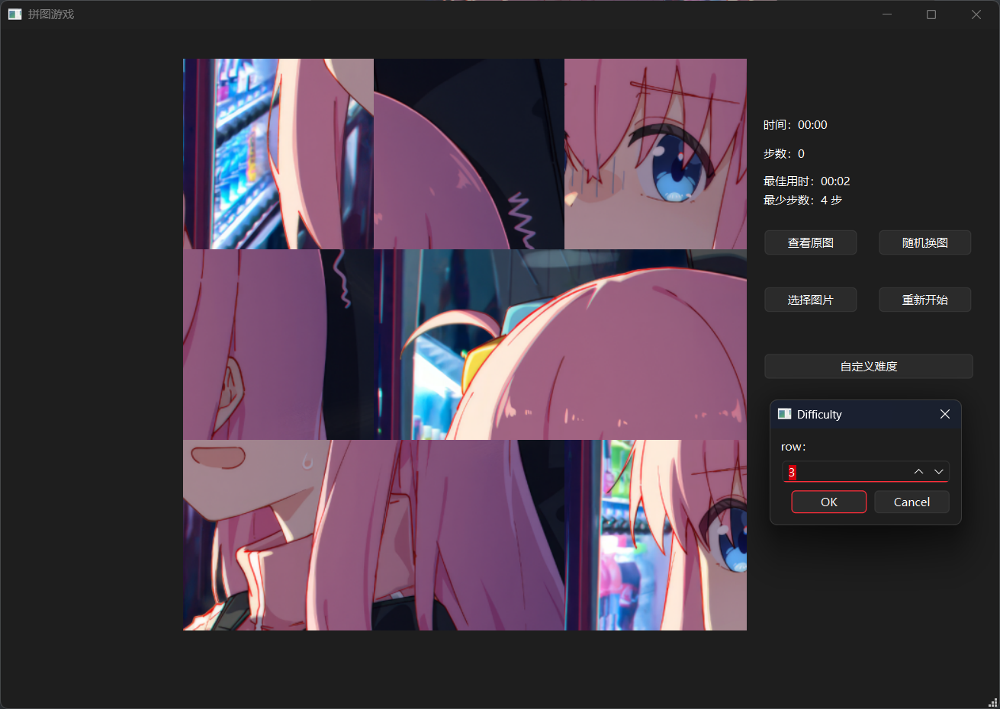
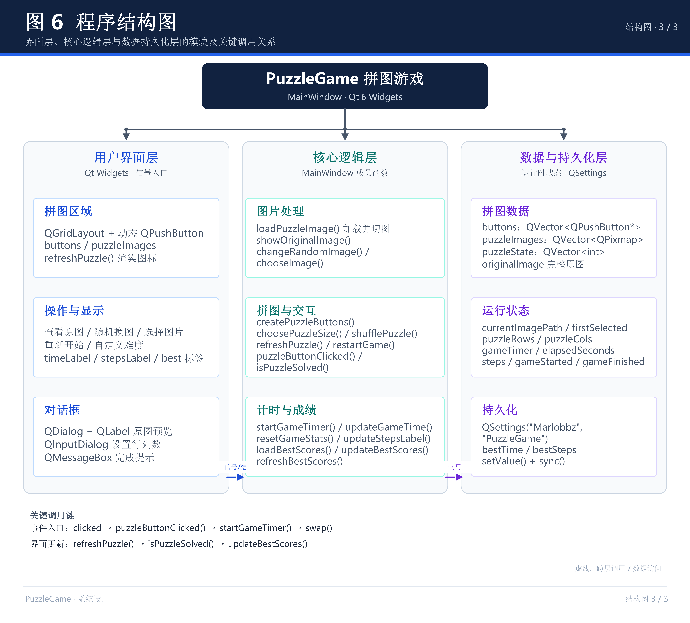

# 1 系统概述

本系统基于 Qt 框架以及 C++ 设计并实现了一个图形化拼图游戏。用户可以通过鼠标点击拼图块，实现两块图片位置的交换，最终将打乱的图片恢复为正确排列。系统支持查看原图、随机切换内置图片、选择本地图片、重新开始游戏以及自定义拼图难度等功能。

在基础拼图功能的基础上，本系统进一步加入了游戏计时、步数统计和最佳成绩记录功能。程序能够记录玩家完成拼图所使用的时间和交换次数，并将历史最佳用时和最少步数保存到本地，使游戏具有一定的挑战性和可重复游玩性。

本项目使用 Qt Widgets 构建图形用户界面，通过 `QPushButton` 实现拼图块的交互，使用 `QPixmap` 完成图片的加载、裁剪、分割和缩放，并利用 Qt 的信号与槽机制连接界面操作与后台程序。

# 2 系统设计

## 2.1 设计目标

本系统的主要设计目标如下：

1. 实现基本的拼图游戏功能，将一张完整图片分割成多个小块，并随机打乱排列顺序。
2. 实现拼图块的点击交换功能，使用户能够通过鼠标操作完成拼图。
3. 实现拼图完成状态判断，当所有图片块恢复正确位置时，提示游戏完成。
4. 支持查看完整原图、切换内置图片以及选择本地图片。
5. 支持自定义拼图行数和列数，使游戏难度可以根据用户需求进行调整。
6. 实现游戏计时和步数统计，记录本局游戏的完成时间和交换次数。
7. 使用本地配置存储保存历史最佳用时和最少步数，使成绩能够在程序重新启动后继续保留。
8. 通过模块化函数设计，将图片处理、界面显示、用户交互和成绩管理等功能分开，提高程序的可读性和可维护性。

## 2.2 设计分析与算法流程

### 数据结构设计

本系统主要使用 `QVector` 保存拼图相关数据。

```c++
QVector<QPushButton*> buttons;
QVector<QPixmap> puzzleImages;
QVector<int> puzzleState;
```

其中：

- `buttons`：动态保存所有拼图按钮的指针，方便统一创建、查找和刷新按钮。
- `puzzleImages`：保存从原图中分割得到的各个拼图块。
- `puzzleState`：保存每个拼图位置对应的图片编号。

例如，在 3×3 拼图中，正确排列状态为：

```
0 1 2
3 4 5
6 7 8
```

如果打乱后变为：

```
3 1 8
0 5 2
6 4 7
```

则说明各个位置显示的图片编号发生了变化。

程序通过 `puzzleState` 记录排列关系，而不是反复移动或重新切割图片。交换拼图时，只需要交换两个位置对应的编号，再根据编号重新显示图片即可。

此外，程序通过 `puzzleRows` 和 `puzzleCols` 分别保存当前拼图的行数和列数，默认值均为 3。拼图块总数由以下公式计算：

```c++
int total=puzzleRows*puzzleCols;
```

这种设计避免了将程序限制在固定的九宫格中，为后续扩展不同难度提供了基础。

### 动态创建拼图按钮（createPuzzleButtons）

函数：

```c++
void MainWindow::createPuzzleButtons()
```

该函数根据当前拼图的行数和列数，动态创建对应数量的 `QPushButton`，并将按钮添加到网格布局 `gridLayout_2` 中。

主要流程如下：

1. 清除网格布局中原有的按钮及布局项，避免重新设置难度后旧按钮与新按钮重叠。
2. 清空 `buttons` 容器，准备保存新创建的按钮。
3. 根据 `puzzleRows * puzzleCols` 计算需要创建的按钮总数。
4. 使用循环创建按钮，并设置按钮的尺寸策略和样式。
5. 根据按钮编号计算其所在的行和列。
6. 将按钮添加到对应的网格位置。
7. 为每个按钮连接 `clicked` 信号，使其能够调用 `puzzleButtonClicked()`。

由于按钮数量由行数和列数决定，因此修改拼图难度后，程序可以重新创建相应数量的按钮，而不需要为不同规格的拼图分别编写界面代码。

### 自定义拼图难度（choosePuzzleSize）

函数：

```c++
void MainWindow::choosePuzzleSize()
```

该函数允许用户自定义拼图的行数和列数，输入范围均为 2～10。

程序使用 `QInputDialog::getInt()` 分别获取用户输入的行数和列数。如果用户取消输入，则直接结束函数，不改变当前游戏。

当用户完成输入后，程序执行以下操作：

1. 保存新的行数和列数。
2. 清除之前的拼图选中状态。
3. 调用 `createPuzzleButtons()`，按照新的规格重新创建拼图按钮。
4. 调用 `loadPuzzleImage()`，重新分割当前图片。
5. 调用 `shufflePuzzle()`，重新打乱拼图。
6. 调用 `resetGameStats()`，清零计时和步数。
7. 调用 `refreshPuzzle()`，更新拼图界面。

最后，程序通过 `QTimer::singleShot()` 延迟刷新一次界面，确保布局完成后能够按照按钮的实际尺寸显示图片。

通过这一设计，程序能够在保留当前图片的情况下重新设置拼图规格，并开启新的一局游戏。

### 图片加载与分割（loadPuzzleImage）

函数：

```c++
bool MainWindow::loadPuzzleImage()
```

该函数负责加载当前图片，并根据拼图的行数和列数，将完整图片分割成对应数量的拼图块，是整个游戏的基础。

主要处理流程如下：

1. 根据 `currentImagePath` 加载图片。
2. 判断图片是否加载成功。如果加载失败，则通过 `QMessageBox` 显示提示信息，并返回 `false`。
3. 将完整图片保存到 `originalImage`，供查看原图功能使用。
4. 根据当前行数和列数计算拼图整体的目标宽高比例。
5. 对图片进行居中裁剪，使图片比例与拼图整体比例一致。
6. 清除之前保存的拼图图片和排列状态。
7. 使用循环，根据每个拼图块的行号、列号和边界坐标，从完整图片中截取对应区域。
8. 将截取的图片保存到 `puzzleImages`，同时将对应的初始编号添加到 `puzzleState`。
9. 全部处理完成后返回 `true`。

图片裁剪的主要逻辑如下：

```c++
double targetRatio=static_cast<double>(puzzleCols)/puzzleRows;
int cropWidth=image.width();
int cropHeight=image.height();
if(static_cast<double>(image.width())/image.height()>targetRatio){
    cropWidth=static_cast<int>(image.height()*targetRatio);
}
else{
    cropHeight=static_cast<int>(image.width()/targetRatio);
}
```

如果原图过宽，则缩小裁剪区域的宽度；如果原图过高，则缩小裁剪区域的高度。随后通过 `QPixmap::copy()` 截取居中的目标区域。

这种方式能够尽量避免图片在切割过程中出现不合理的拉伸，并使拼图块的整体比例与游戏区域保持一致。

在分割图片时，程序使用以下公式计算每个拼图块的边界：

```c++
int x1=col*image.width()/puzzleCols;
int x2=(col+1)*image.width()/puzzleCols;
int y1=row*image.height()/puzzleRows;
int y2=(row+1)*image.height()/puzzleRows;
```

通过分别计算相邻边界的位置，可以避免直接使用固定宽高时出现剩余像素无法分配的问题。

### 拼图打乱与显示（shufflePuzzle、refreshPuzzle）

`shufflePuzzle()` 负责随机打乱拼图块的排列顺序。

程序首先清空 `puzzleState`，然后按照拼图块的总数生成从 0 开始的连续编号，最后利用 C++ 标准库中的随机数工具打乱编号。

```c++
random_device rd;
mt19937 g(rd());
shuffle(puzzleState.begin(),puzzleState.end(),g);
```

其中，`random_device` 用于提供随机种子来源，`mt19937` 是随机数生成器，`shuffle()` 则负责打乱容器中的元素顺序。

需要注意的是，本系统采用任意两块拼图均可交换的规则，因此不需要按照传统滑块拼图的移动规则生成可解排列。

`refreshPuzzle()` 负责刷新拼图界面。程序遍历 `buttons` 容器，根据 `puzzleState` 获取当前位置对应的图片编号，再从 `puzzleImages` 中取出相应图片。

```c++
int imageIndex=puzzleState[i];
```

之后，程序使用 `QPixmap::scaled()` 将图片缩放到按钮的实际尺寸，并通过 `setIcon()` 和 `setIconSize()` 设置按钮图标。

这种设计将图片数据、排列状态和界面显示分开管理。当图片顺序发生变化时，只需要修改排列状态并刷新界面即可。

### 拼图交换（puzzleButtonClicked）

函数：

```c++
void MainWindow::puzzleButtonClicked()
```

该函数是整个拼图游戏的核心交互函数，负责处理用户点击拼图块的操作。

程序通过 `sender()` 获取触发信号的按钮，再利用 `buttons.indexOf()` 查找按钮在容器中的位置编号。

为了实现两次点击交换的功能，程序使用 `firstSelected` 保存第一次点击的位置。其初始值为 `-1`，表示当前没有选中的拼图块。

主要流程如下：

1. 判断游戏是否已经完成。如果已经完成，则不再接受拼图交换操作。
2. 获取当前触发点击事件的按钮。
3. 查找该按钮在 `buttons` 容器中的位置。如果没有找到，则结束函数。
4. 如果当前没有选中的拼图块，则将该位置保存到 `firstSelected`，等待第二次点击。
5. 如果第二次点击的是同一块拼图，则取消选择。
6. 如果第二次点击的是另一块拼图，则启动游戏计时，并交换两个位置在 `puzzleState` 中对应的编号。
7. 将 `steps` 加一，更新步数显示。
8. 清除选中状态，调用 `refreshPuzzle()` 刷新界面。
9. 调用 `isPuzzleSolved()` 判断拼图是否完成。
10. 如果拼图完成，则设置游戏完成标记、停止计时、更新最佳成绩，并通过消息框显示本局用时和步数。

交换操作的核心代码为：

```c++
swap(puzzleState[firstSelected],
     puzzleState[index]);
steps++;
updateStepsLabel();
firstSelected=-1;
refreshPuzzle();
```

其中，`swap()` 只交换两个位置对应的图片编号，并不直接交换图片对象。界面刷新时，再根据新的编号关系显示对应图片。

本系统采用点击交换而不是拖动交换，操作方式较为直接，同时也简化了鼠标交互逻辑。系统允许交换任意两块拼图，不限制为相邻拼图块。

### 拼图完成判断（isPuzzleSolved）

函数：

```c++
bool MainWindow::isPuzzleSolved()
```

该函数用于判断当前拼图是否已经恢复正确排列。

程序遍历 `puzzleState` 中的所有元素，判断每个位置上的图片编号是否与该位置的编号相同。

```c++
for (int i=0; i<puzzleState.size();i++){
    if (puzzleState[i]!=i) return false;
}
return true;
```

如果发现任意一个位置上的图片编号不正确，函数立即返回 `false`；只有所有位置都正确时，才返回 `true`。

这种方法直接利用数组下标与图片编号之间的对应关系进行判断，逻辑简单，易于理解和维护。

由于本系统允许任意两块拼图交换，因此玩家能够通过不断交换位置恢复正确排列，完成状态判断不需要考虑传统滑块拼图中的移动限制。

### 查看原图（showOriginalImage）

函数：

```c++
void MainWindow::showOriginalImage()
```

该函数用于显示当前拼图对应的完整原图，帮助玩家了解正确图片的整体内容。

程序首先创建一个 `QDialog` 对话框，再创建一个 `QLabel` 用于显示图片。

```cmake
QPixmap showImage = originalImage.scaled(
    600,
    600,
    Qt::KeepAspectRatio,
    Qt::SmoothTransformation
);
```

其中，`Qt::KeepAspectRatio` 表示缩放时保持原图比例，`Qt::SmoothTransformation` 用于改善缩放后的显示效果。

随后，程序将缩放后的图片设置到标签中，并通过 `QVBoxLayout` 将标签添加到对话框布局中。

最后调用 `dialog.exec()` 显示对话框。玩家关闭对话框后即可返回游戏界面。

### 随机切换图片与选择本地图片

系统提供两种更换图片的方式。

**1. 随机切换内置图片（changeRandomImage）**

程序预先设置了三张内置图片：

```c++
QString imagePaths[3]=
{
    ":/image/test.png",
    ":/image/test2.png",
    ":/image/test3.png"
};
```

通过随机数生成器选择新的图片路径，并使用循环避免连续选择当前图片。

选定新图片后，程序调用 `loadPuzzleImage()` 加载并切割图片。如果加载失败，则恢复原来的图片路径并结束操作；如果加载成功，则重新打乱拼图、清除选中状态、重置计时与步数，最后刷新界面。

**2. 选择本地图片（chooseImage）**

程序通过 `QFileDialog::getOpenFileName()` 打开文件选择对话框，允许用户选择 PNG、JPG、JPEG 或 BMP 格式的图片。

```c++
QString fileName=QFileDialog::getOpenFileName(
    this,
    "选择图片",
    "",
    "图片文件 (*.png *.jpg *.jpeg *.bmp)"
);
```

如果用户取消选择，函数直接返回，不改变当前游戏。

如果选择了新图片，程序会尝试加载该图片。只有加载成功后，才会重新打乱拼图并重置统计数据；如果加载失败，则恢复原图片路径，避免直接丢失当前游戏状态。

### 重新开始游戏（restartGame）

函数：

```c++
void MainWindow::restartGame()
```

该函数负责重新开始当前游戏，不更换图片，也不改变当前拼图的行数和列数。

主要流程如下：

1. 将 `firstSelected` 设置为 `-1`，清除之前的选中状态。
2. 调用 `shufflePuzzle()`，重新打乱当前拼图。
3. 调用 `resetGameStats()`，停止计时并清零本局用时和步数。
4. 调用 `refreshPuzzle()`，更新拼图显示。

重新开始游戏时，程序不会重新加载和分割图片，因此可以直接利用已经保存的 `puzzleImages`，减少不必要的重复处理。

### 游戏计时与步数统计

本系统使用 `QTimer` 实现游戏计时，并通过整数变量记录本局游戏的数据。

相关成员变量如下：

```c++
QTimer *gameTimer;
int elapsedSeconds=0;
int steps=0;
bool gameStarted=false;
bool gameFinished=false;
```

其中：

- `gameTimer`：游戏计时器，每隔一秒触发一次信号。
- `elapsedSeconds`：记录本局已用时间，单位为秒。
- `steps`：记录本局成功交换拼图块的次数。
- `gameStarted`：标记计时是否已经开始，避免重复启动。
- `gameFinished`：标记游戏是否已经完成，防止完成后继续交换拼图。

本系统通过以下函数完成计时与步数管理：

- `startGameTimer()`：首次进行有效交换时启动计时器。
- `updateGameTime()`：每次收到 `timeout` 信号时，将时间增加一秒，并更新界面显示。
- `updateStepsLabel()`：根据当前 `steps` 更新步数标签。
- `resetGameStats()`：停止计时器，清零时间和步数，重置游戏状态。
- `stopGameTimer()`：停止计时器，结束本局计时。

计时器在第一次点击两块不同拼图并执行交换时启动。单纯点击一块拼图，或者再次点击同一块拼图取消选择，都不会增加步数。

当拼图完成时，程序停止计时并显示本局成绩。重新开始游戏、切换图片或调整难度时，程序会重置本局统计数据，保证新的一局游戏从零开始。

### 最佳成绩记录（loadBestScores、updateBestScores）

本系统使用 `QSettings` 保存和读取历史最佳成绩。

程序启动时，`loadBestScores()` 从本地配置中读取 `bestTime` 和 `bestSteps`。如果没有历史记录，则使用 `-1` 表示暂无成绩。

```c++
QSettings settings("Marlobbz","PuzzleGame");
bestTime=settings.value("bestTime",-1).toInt();
bestSteps=settings.value("bestSteps",-1).toInt();
```

当玩家完成拼图后，`updateBestScores()` 会将本局成绩与历史记录进行比较：

- 如果尚无最佳用时记录，或者本局用时更短，则更新最佳用时。
- 如果尚无最少步数记录，或者本局步数更少，则更新最少步数。

更新后的成绩通过 `QSettings::setValue()` 写入本地配置，并在有成绩变化时调用 `sync()` 同步数据。

`refreshBestScores()` 负责将成绩显示在界面上。如果没有历史记录，则显示“暂无”；否则将秒数转换为分、秒格式，或者显示最少步数。

需要注意的是，本系统分别保存最佳用时和最少步数，两项成绩独立比较，不要求它们来自同一局游戏。

### 算法流程图

图 1 展示了程序从启动、初始化到进入游戏主循环，再在完成拼图后进行收尾的整体过程；图 2 对图 1 中的“处理按钮事件”进行了展开，重点说明两次点击选择、编号交换、步数更新和完成判定的具体分支。

**图 1：拼图游戏整体运行流程**



**图 2：拼图交换与完成判断流程**


在图 2 中，只有第二次点击与第一次选择不同时才会执行交换并增加步数。交换完成后，如果 `isPuzzleSolved()` 返回 `true`，程序停止计时、比较并保存最佳成绩；否则结束本次事件处理，返回等待下一次操作。

## 2.3 界面设计

本系统采用 Qt Designer 设计主窗口，通过布局管理器组织拼图区域、功能按钮和统计信息。

拼图区域采用网格布局 `QGridLayout`，使拼图按钮能够按照当前设置的行数和列数排列。按钮的数量由程序动态创建，不需要在 Qt Designer 中提前固定所有拼图块。

界面主要包括以下部分：

1. **拼图显示区域**：显示当前打乱后的拼图块，支持鼠标点击交换。
2. **查看原图按钮**：打开独立对话框，显示完整原图。
3. **随机换图按钮**：从内置图片中随机选择一张新图片。
4. **选择图片按钮**：打开文件选择对话框，导入本地图片。
5. **重新开始按钮**：重新打乱当前图片，并重置本局统计信息。
6. **难度设置按钮**：允许用户设置拼图的行数和列数。
7. **游戏统计区域**：显示当前用时、步数、最佳用时和最少步数。

主窗口初始化时，程序通过 `ui->setupUi(this)` 加载界面，再通过 `connect()` 将功能按钮的点击信号与相应的成员函数连接起来。

例如，随机换图按钮的连接方式为：

```cmake
connect(
    ui->randomImageButton,
    &QPushButton::clicked,
    this,
    &MainWindow::changeRandomImage
);
```

当用户点击按钮时，Qt 会发出 `clicked` 信号，并调用 `changeRandomImage()` 函数完成相应操作。

这种设计将界面操作与后台逻辑连接起来，避免在每个按钮上重复编写相同的事件处理代码。

**图 3：程序运行界面**



**图 4：查看原图界面**



**图 5：自定义难度界面**



# 3 系统实现与运行调试

## 3.1 系统实现

本项目的主要开发环境和技术如下：

| 项目         | 内容                         |
| ------------ | ---------------------------- |
| 编程语言     | C++                          |
| GUI 框架     | Qt 6                         |
| 开发工具     | Qt Creator                   |
| 界面设计工具 | Qt Designer                  |
| 构建工具     | CMake                        |
| 图片处理     | QPixmap、QIcon               |
| 界面控件     | QPushButton、QLabel、QDialog |
| 数据结构     | QVector                      |
| 定时功能     | QTimer                       |
| 本地数据存储 | QSettings                    |
| 信号与槽     | Qt Signals & Slots           |
| 随机打乱     | C++ 标准库 shuffle           |

**程序主要构成：**

- `main.cpp`：程序入口，负责创建应用程序对象并启动主窗口。
- `mainwindow.h`：声明主窗口类、成员变量以及各个功能函数。
- `mainwindow.cpp`：实现图片处理、拼图交互、界面刷新、计时和成绩管理等核心逻辑。
- `mainwindow.ui`：保存通过 Qt Designer 设计的界面布局。
- `resources.qrc`：管理内置图片等 Qt 资源文件。
- `CMakeLists.txt`：配置项目构建过程、源文件、资源文件以及 Qt 模块依赖。

**图 6：程序结构图**



程序以 `MainWindow` 作为控制核心，界面层通过信号与槽调用核心逻辑层；核心逻辑层负责图片处理、拼图管理、交互判定以及计时与成绩管理；数据与持久化层保存 `QVector` 运行时数据，并使用 `QSettings` 保存历史最佳成绩。图中的虚线表示跨层调用与数据访问关系。

### 核心成员函数与职责

| 函数                    | 主要职责                   |
| ----------------------- | -------------------------- |
| `createPuzzleButtons()` | 根据行列数动态创建拼图按钮 |
| `choosePuzzleSize()`    | 设置拼图行数和列数         |
| `loadPuzzleImage()`     | 加载、裁剪和分割图片       |
| `shufflePuzzle()`       | 随机打乱拼图排列           |
| `refreshPuzzle()`       | 根据排列状态刷新拼图显示   |
| `puzzleButtonClicked()` | 处理点击事件及拼图交换     |
| `isPuzzleSolved()`      | 判断拼图是否完成           |
| `showOriginalImage()`   | 显示完整原图               |
| `changeRandomImage()`   | 随机切换内置图片           |
| `chooseImage()`         | 选择并加载本地图片         |
| `restartGame()`         | 重新打乱当前拼图           |
| `startGameTimer()`      | 启动游戏计时               |
| `updateGameTime()`      | 更新用时显示               |
| `resetGameStats()`      | 重置本局计时和步数         |
| `loadBestScores()`      | 读取历史最佳成绩           |
| `updateBestScores()`    | 比较并保存新成绩           |
| `refreshBestScores()`   | 更新最佳成绩显示           |

### 资源文件配置

项目使用 Qt 资源系统管理内置图片。图片资源通过 `resources.qrc` 添加，并通过类似以下路径进行访问：

```c++
":/image/test.png"
```

为了使 CMake 项目能够正确处理 `.qrc` 文件，本项目在 `CMakeLists.txt` 中显式开启了自动资源编译功能：

```cmake
set(CMAKE_AUTORCC ON)
```

同时，在 `qt_add_executable()` 中加入 `resources.qrc`，确保资源文件能够参与程序构建。

通过 Qt 资源系统，内置图片可以直接从程序资源中加载，不需要依赖运行时的当前工作目录来查找图片文件。

## 3.2 运行调试

为检验系统功能，设计以下测试项目。

**测试 1：程序初始化**

- 操作：启动程序。
- 预期结果：显示主窗口，自动创建默认的 3×3 拼图，并加载内置图片。
- 检查内容：拼图区域显示正常，按钮数量正确，计时和步数初始化为零。

**测试 2：拼图交换**

- 操作：依次点击两块不同的拼图。
- 预期结果：两块拼图对应的图片位置发生交换。
- 检查内容：拼图排列正确更新，步数增加一次，计时开始。

**测试 3：重复点击同一块拼图**

- 操作：连续两次点击同一块拼图。
- 预期结果：取消第一次选择，不执行交换。
- 检查内容：拼图状态不变，步数不增加。

**测试 4：完成拼图**

- 操作：通过交换拼图块，使所有图片恢复正确位置。
- 预期结果：程序识别拼图完成，停止计时，并显示完成提示。
- 检查内容：本局用时和步数显示正确，最佳成绩根据比较结果更新。

**测试 5：查看原图**

- 操作：点击查看原图按钮。
- 预期结果：弹出对话框，显示当前完整图片。
- 检查内容：图片能够正常显示，缩放后保持宽高比例。

**测试 6：随机切换图片**

- 操作：点击随机换图按钮。
- 预期结果：从内置图片中选择一张不同于当前图片的图片。
- 检查内容：图片重新分割并打乱，本局计时和步数清零。

**测试 7：选择本地图片**

- 操作：点击选择图片按钮，选择一张支持格式的图片。
- 预期结果：加载图片并重新生成拼图。
- 检查内容：图片正常显示，拼图状态和统计数据重新初始化。

**测试 8：重新开始游戏**

- 操作：点击重新开始按钮。
- 预期结果：当前图片重新打乱。
- 检查内容：拼图难度和当前图片保持不变，计时和步数重置。

**测试 9：自定义拼图难度**

- 操作：将拼图行数和列数设置为其他合法值，例如 4×4。
- 预期结果：拼图区域重新创建相应数量的按钮。
- 检查内容：图片按照新的规格重新切割，拼图能够正常交换和完成判断。

**测试 10：最佳成绩持久化**

- 操作：完成一局游戏并更新最佳成绩，关闭程序后重新启动。
- 预期结果：历史最佳用时和最少步数仍然显示。
- 检查内容：`QSettings` 能够正确读取先前保存的数据。

# 4 系统扩展

本系统在基本拼图游戏的基础上进行了多项功能扩展。

## 4.1 自定义拼图规格

传统的简单拼图程序通常使用固定数量的按钮，只支持 3×3 拼图。本系统通过 `puzzleRows`、`puzzleCols` 和 `QVector` 实现动态创建按钮，使用户能够将拼图设置为 2～10 行、2～10 列。

该功能将拼图规格与界面创建逻辑分离，减少了固定布局带来的限制。

## 4.2 图片来源扩展

系统除了提供内置图片随机切换功能，还加入了本地图片选择功能。

用户可以使用自己的图片进行游戏。程序在加载图片后，根据当前拼图规格重新裁剪和分割图片，因此不需要为不同图片单独编写处理逻辑。

此外，通过居中裁剪和缩放显示，程序能够适应不同宽高比例的图片。

## 4.3 计时与步数统计

系统加入 `QTimer` 作为游戏计时器，并使用 `elapsedSeconds` 和 `steps` 记录本局游戏数据。

计时从第一次有效交换开始，在拼图完成时停止。每次成功交换两块不同的拼图，步数增加一次。

通过计时与步数统计，用户可以比较不同玩法的完成效率，使游戏不再只是简单的图片排列操作。

## 4.4 最佳成绩保存

系统使用 `QSettings` 将最佳用时和最少步数保存在本地配置中。

与只使用普通变量保存成绩不同，`QSettings` 能够将数据持久化，使成绩在程序关闭后仍然可以读取。

两项成绩分别进行比较和更新，便于用户从时间和操作次数两个方面了解自己的游戏表现。

## 4.5 模块化设计

程序将主要功能划分为图片处理、拼图排列、界面刷新、用户交互、计时和成绩管理等部分。

例如，切换图片时主要调用图片加载、拼图打乱、统计重置和界面刷新等函数，而不需要重新实现所有底层逻辑。

这种模块化设计减少了重复代码，也使后续增加新的功能更加方便。

# 5 总结

本项目基于 C++ 和 Qt 框架，实现了一个具有图形化交互能力的拼图游戏。通过本次设计，综合学习和运用了 Qt 图形界面开发、信号与槽机制、图片处理、容器使用、随机数生成、定时器以及本地配置存储等知识。

在基础功能方面，系统实现了图片加载、裁剪、分割、随机打乱、拼图交换和完成状态判断。通过 `QPixmap` 处理图片，通过 `QPushButton` 实现交互，并利用 `puzzleState` 记录拼图的排列关系，使图片数据与界面显示能够相对独立地管理。

在扩展功能方面，系统实现了内置图片随机切换、本地图片选择、查看原图、重新开始和自定义拼图规格。同时，通过 `QTimer` 实现游戏计时，通过步数变量统计交换次数，并利用 `QSettings` 保存历史最佳用时和最少步数，进一步完善了游戏体验。

在程序设计过程中，动态创建拼图按钮和分离图片数据、排列状态的设计，使我对容器的使用和模块化编程有了更加直观的理解。通过信号与槽机制，也进一步熟悉了 Qt 中界面事件与后台函数之间的连接方式。

当然，本系统仍然存在一定的扩展空间。例如，可以进一步加入拖动交换、撤销操作、不同的拼图规则、更多内置图片以及更完善的界面反馈等功能。

总体而言，本项目基本达到了预期的设计目标，实现了一个功能较为完整、操作简单且具有一定扩展能力的 Qt 拼图游戏。通过本次课程设计，不仅加深了对 C++ 基础知识的理解，也进一步掌握了 Qt 图形界面程序的开发方法，为后续学习更复杂的桌面应用程序开发奠定了基础。
